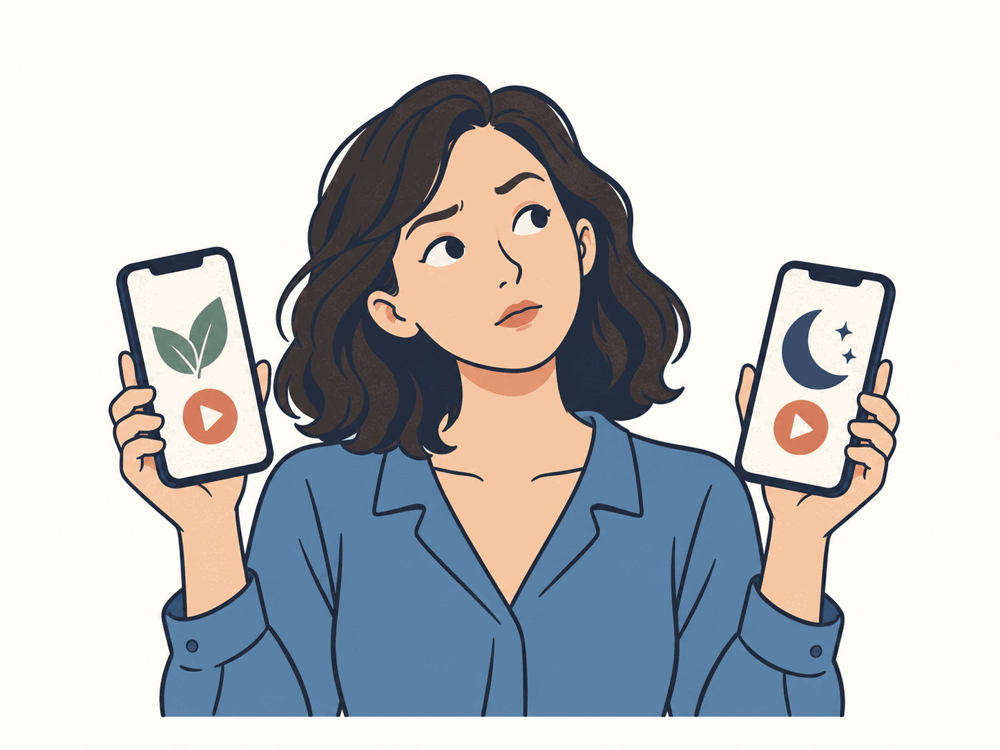

# Randomised Controlled Trials {#sec-rcts}

_Written for this book by Giorgio Arcara, with an AI assistant (Claude). This chapter is not in Irizarry's *Introduction to Data Science*._

:::{.callout-warning}
## Draft
This chapter is a **draft**, written with an AI assistant (Claude) on 21 November 2026, and not yet reviewed by the instructor. It may be substantially rewritten or removed.
:::

<!-- 21 Nov 2026 (Claude): new chapter, at the instructor's request. Built on the Week 9 deck 09-02-Experiments-and-RCTs (behds-course-slides/Week09/), whose figures are redrawn here in ggplot2 (the slides use TikZ); the "Why randomise?" simulation and the pre-post numbers are the slides' own. It expands the short subsection "Randomised controlled trials and A/B tests" of behav/experimental-designs.qmd, which now points here. The image in fig-two-apps is the AI-generated illustration Figures/week06-two-apps-comparison.png of the slides repo. To review. -->

```{r, message=FALSE, warning=FALSE}
#| cache: false
library(tidyverse)
navy <- "#001238"
```

```{r flow-helper}
#| include: false
# Draws the box-and-arrow diagrams of this chapter. `nodes`: x, y, label,
# key ("yes" = highlighted box); `edges`: x, y, xend, yend; `notes`: x, y, label.
draw_flow <- function(nodes, edges, notes = NULL, xlim, ylim) {
  p <- ggplot() +
    geom_segment(data = edges, aes(x, y, xend = xend, yend = yend),
                 arrow = arrow(length = unit(0.16, "cm"), type = "closed"),
                 colour = "grey40", linewidth = 0.5) +
    geom_label(data = nodes, aes(x, y, label = label, fill = key, colour = key),
               size = 3.6, lineheight = 0.9, label.padding = unit(0.5, "lines"),
               label.r = unit(0.2, "lines")) +
    scale_fill_manual(values = c(yes = navy, no = "grey95"), guide = "none") +
    scale_colour_manual(values = c(yes = "white", no = "black"), guide = "none")
  if (!is.null(notes)) {
    p <- p + geom_text(data = notes, aes(x, y, label = label), size = 3.3,
                       fontface = "italic", colour = "grey35", lineheight = 0.9)
  }
  p + coord_cartesian(xlim = xlim, ylim = ylim) + theme_void()
}
```

In @sec-association-causality we saw that an association between two variables, such as notifications and stress, does not tell us whether one causes the other. Workload, or some variable nobody measured, could produce both. We also saw that a causal claim needs three things: the cause and the outcome covary, the cause comes first, and the alternative explanations have been ruled out. Experiments are the design that deals most directly with the third requirement.

This chapter is about one family of experiments that you will meet constantly in behavioural research and in technology: the **randomised controlled trial** (RCT). An RCT is an experiment that tests an *intervention*, such as a therapy, a training programme, or an app, by randomly assigning people to receive it or to receive something else, and comparing what happens to the two groups. It is the design behind the question "does it work?", whether "it" is a new drug, a mindfulness app, or a new version of a screen. We first look at what makes an experiment and why randomisation matters, then at how a trial is built, and finally at the problems that are common in trials: the comparison with the baseline, dropout, and the novelty effect. The industry version of the RCT, the A/B test, closes the chapter.

## What makes an experiment

Two features turn a study into an experiment (@fig-experiment). First, the researcher **manipulates** something: they decide who uses the app and who does not, instead of observing who happens to use it. Second, **chance decides** who gets what. This second feature is called *random assignment* (see *Random assignment* in @sec-experimental-designs), and it is what makes the comparison between conditions fair.

```{r}
#| label: fig-experiment
#| echo: false
#| fig-cap: "The structure of an experiment. Participants are assigned at random to one of two conditions that the researcher manipulates, and the outcome is compared between the conditions."
#| fig-width: 7
#| fig-height: 2.6
#| out-width: 95%
nodes <- tribble(
  ~x, ~y, ~label, ~key,
  0, 0, "participants", "no",
  3, 0, "random\nassignment", "yes",
  6, 0.9, "condition A", "no",
  6, -0.9, "condition B", "no",
  9, 0, "outcome", "no"
)
edges <- tribble(
  ~x, ~y, ~xend, ~yend,
  0.85, 0, 2.15, 0,
  3.85, 0.2, 5.05, 0.8,
  3.85, -0.2, 5.05, -0.8,
  6.95, 0.8, 8.3, 0.2,
  6.95, -0.8, 8.3, -0.2
)
notes <- tribble(
  ~x, ~y, ~label,
  6, 1.7, "the researcher manipulates",
  3, -1.05, "chance decides\nwho gets what"
)
draw_flow(nodes, edges, notes, xlim = c(-0.6, 9.6), ylim = c(-1.5, 2))
```

The manipulation guarantees that the cause comes before the outcome. Random assignment deals with the alternative explanations, and it deserves a closer look.

## Why randomise?

Suppose we want to know whether a stress-management app reduces stress. The simplest study would compare people who chose to use the app with people who did not. The problem is that the people who choose an app differ from those who do not: they may be more motivated to reduce their stress, and motivated people may do many other things that reduce stress too. If the app users end the study less stressed, we cannot tell whether this is the app or the motivation.

We can see the problem with a small simulation. We give 40 simulated people a level of motivation between 0 and 1, which in a real study we would not measure. In the first scheme, people choose whether to use the app, and the more motivated they are, the more likely they are to choose it. In the second, a coin decides: we shuffle 20 "app" and 20 "no app" labels and hand them out.

```{r why-randomise-data}
set.seed(9)
n <- 40
motivation <- runif(n)
# people choose: the probability of using the app grows with motivation
chose <- rbinom(n, 1, plogis(-3 + 6 * motivation))
# random assignment: 20 of each, in random order
random <- sample(rep(0:1, each = n / 2))

rand_d <- bind_rows(
  tibble(scheme = "people chose the app", app = chose, motivation),
  tibble(scheme = "assigned at random", app = random, motivation)) |>
  mutate(app = factor(app, levels = 0:1, labels = c("no app", "app")),
         scheme = fct_inorder(scheme))

rand_d |>
  group_by(scheme, app) |>
  summarise(n = n(), mean_motivation = mean(motivation))
```

When people choose, the app group is much more motivated than the no-app group, by about 0.4, and the difference is built into the way the groups were formed: repeat the study and it will be there again. When a coin decides, the groups still differ, by about 0.15, but in the other direction, and only by chance: repeat the randomisation and the difference will change size and sign, averaging zero over many repetitions (@fig-why-randomise).

```{r}
#| label: fig-why-randomise
#| echo: false
#| fig-cap: "The same 40 simulated people, split into an app group and a no-app group in two ways. Each point is a person, and darker points are more motivated; the horizontal bars are the group means. When people choose, the motivated ones end up in the app group. When the groups are assigned at random, the difference that remains is due to chance alone, and motivation is balanced on average, even though it was never measured."
#| fig-width: 7
#| fig-height: 3.2
ggplot(rand_d, aes(app, motivation, colour = motivation)) +
  geom_jitter(width = 0.15, height = 0, size = 2.4) +
  stat_summary(fun = mean, geom = "crossbar", width = 0.5,
               colour = "grey30", linewidth = 0.4) +
  facet_wrap(~scheme) +
  scale_colour_gradient(low = "grey85", high = navy, guide = "none") +
  labs(x = NULL, y = "motivation (not measured)") +
  theme_minimal() +
  theme(panel.grid.minor = element_blank(),
        strip.text = element_text(face = "bold", size = 11),
        axis.text.y = element_blank())
```

This is the key point of randomisation: it balances not only the variables we measured but also the ones we did not, such as motivation, sleep, or the number of exams that month. Because chance decides who gets the app, no characteristic of the participants can systematically push them into one group. Any remaining difference between the groups at the end of the study is either the effect of the app or chance, and chance is exactly what the statistical methods of the following chapters are designed to quantify.

Two caveats. Randomisation balances the groups *on average*: in a single small study, the two groups can still differ by chance, as they do in our simulation (run it again with other seeds to see the difference change). Larger samples make large chance imbalances less likely, and blocked or stratified randomisation can balance a few important variables by design (see *Matching, blocking, and stratification* in @sec-experimental-designs). And randomisation only protects the comparison between the groups; it says nothing about whether the result applies to people unlike those in the study (see *Random sampling* in @sec-experimental-designs).

## What do we compare with?

A trial compares the intervention with a **control condition**, and the choice of control decides what question the trial answers. In a **passive control**, participants receive nothing new and continue their usual routine. A difference from a passive control tells us that using the app is better than doing nothing, but the app brings many things at once: daily attention to one's stress, notifications, the expectation of feeling better. In an **active control**, participants receive something that matches these non-specific features without the component thought to work, such as a neutral app with the same number of notifications. A difference from an active control is much more specific: it is about what the app does, not about the fact that it is an app.

Whatever the control, it helps to **blind** whoever can be blinded: the participants, who may report what they think the study expects (*demand characteristics*), the people who assess the outcome, and the analysts. In app trials, participants usually know which app they are using, but the assessor and the analyst can often be kept unaware of the group. The section *Variables and experimental control* and the section *Bias and control procedures* of @sec-experimental-designs discuss controls, manipulation checks and blinding in more detail.

## Anatomy of a trial

@fig-rct-flow shows the most common form of RCT, the **parallel-arm** trial. People are recruited and assessed at the start (the *baseline*); then they are randomised to one of the arms (here, the app or an active control); after the intervention period, everyone is assessed again and the arms are compared. Note that randomisation comes *after* the baseline assessment: this way, the assessment cannot be influenced by knowing which group a person is in, and the baseline can be used to check that the groups started from similar values.

```{r}
#| label: fig-rct-flow
#| echo: false
#| fig-cap: "A parallel-arm randomised controlled trial. Participants are assessed at baseline, randomised to the intervention or to a control condition, and assessed again at the end; the two arms are then compared."
#| fig-width: 8
#| fig-height: 2.4
#| out-width: 100%
nodes <- tribble(
  ~x, ~y, ~label, ~key,
  0, 0, "recruited", "no",
  2.1, 0, "assessed\n(baseline)", "no",
  4.3, 0, "randomised", "yes",
  6.9, 0.8, "app", "no",
  6.9, -0.8, "active control", "no",
  9.6, 0, "assessed again,\ncompared", "no"
)
edges <- tribble(
  ~x, ~y, ~xend, ~yend,
  0.75, 0, 1.35, 0,
  2.85, 0, 3.4, 0,
  5.2, 0.15, 6.4, 0.75,
  5.2, -0.15, 5.9, -0.7,
  7.4, 0.75, 8.55, 0.2,
  7.9, -0.75, 8.55, -0.2
)
draw_flow(nodes, edges, xlim = c(-0.6, 10.7), ylim = c(-1.3, 1.3))
```

In a parallel-arm trial, each person receives one condition only, which is a between-subjects design. In a **crossover** trial, each person receives both conditions, one after the other, in a random order: half use the app first and the control second, half the reverse. This is a within-subjects design, with its advantages (each person is compared with themselves, so fewer participants are needed) and its problems (the first condition can leave traces that carry over into the second, so a crossover only works when the effect wears off between the two periods). The random order is a form of the counterbalancing described in *Within-subjects designs* in @sec-experimental-designs.

## Before and after is not enough

Since a trial measures people before and after the intervention, it is tempting to look only at the change in the intervention group. Suppose the average stress of the people who used the app went from 5.9 to 4.5. Did the app work? Not necessarily. Without a control group, the change could have many other causes:

- something changed in everyone's life: the study started in the exam week, and the exams ended;
- people got used to the questionnaire and answered it differently the second time;
- people who joined because they were very stressed at that moment would have been less stressed a few weeks later anyway, a phenomenon called **regression to the mean**.

A control group experiences all of these too. @fig-prepost shows the means of the two groups at the two assessments: the control group also improved, from 5.8 to 5.4, without any app.

```{r}
#| label: fig-prepost
#| echo: false
#| fig-cap: "Illustrative mean stress of an app group and a control group, before and after the intervention period. Both groups improve; the question is whether the app group improved more."
#| fig-width: 5
#| fig-height: 3.4
#| out-width: 60%
prepost <- tribble(
  ~time, ~group, ~stress,
  "before", "control", 5.8,
  "after", "control", 5.4,
  "before", "app", 5.9,
  "after", "app", 4.5) |>
  mutate(time = factor(time, levels = c("before", "after")))
ggplot(prepost, aes(time, stress, group = group, colour = group)) +
  geom_line(linewidth = 1) +
  geom_point(size = 3) +
  scale_colour_manual(values = c(app = navy, control = "grey60")) +
  labs(x = NULL, y = "mean stress", colour = NULL) +
  theme_minimal() +
  theme(panel.grid.minor = element_blank(), legend.position = "top")
```

The question a trial answers is therefore not "did the app group change?" but "**did the app group change more than the control group?**". Here, the app group improved by 1.4 points and the control group by 0.4, so the part of the improvement we can attribute to the app is about 1 point, not 1.4. Whether a difference of this size could be due to chance is a question for the comparison of two groups (@sec-two-groups), and how many participants are needed to detect it reliably is a question of power (@sec-power). The pre-post comparison is also discussed in *Pre-post designs and baseline measurements* in @sec-experimental-designs.

## Who drops out matters

Trials that last weeks or months lose participants along the way: people stop using the app, stop answering the questionnaires, or leave the study. Dropout would be a minor problem if it happened at random. It rarely does. In @fig-dropout, each dot is a participant, and darker dots are more stressed. In the control group one person, with average stress, dropped out. In the app group the three most stressed participants dropped out, perhaps because the app did not help them, or because they had too much on their plate to keep using it.

```{r}
#| label: fig-dropout
#| echo: false
#| fig-cap: "Illustrative dropout in a trial. Each dot is a participant; darker dots are more stressed. In the app group, the three most stressed participants dropped out before the end (dashed circles), so the participants who completed the study look less stressed than the group that was randomised."
#| fig-width: 7.5
#| fig-height: 2.4
#| out-width: 95%
dots <- expand_grid(group = c("app", "control"), id = 1:10, time = c("start", "end")) |>
  mutate(stress = id / 10,
         x = id + if_else(time == "end", 11.5, 0),
         y = if_else(group == "app", 1, 0),
         dropped = time == "end" &
           ((group == "app" & id %in% 8:10) | (group == "control" & id == 4)))
ggplot(dots, aes(x, y)) +
  geom_point(data = filter(dots, !dropped), aes(fill = stress),
             shape = 21, size = 5, colour = "white") +
  geom_point(data = filter(dots, dropped), shape = 21, size = 5,
             colour = "grey60", fill = "white", stroke = 0.6) +
  annotate("text", x = c(5.5, 17), y = 1.75, label = c("start", "end"),
           colour = "grey35", size = 3.6) +
  annotate("text", x = -0.6, y = c(1, 0), label = c("app", "control"),
           hjust = 1, fontface = "bold", size = 3.8) +
  annotate("segment", x = 10.7, xend = 12, y = 0.5, yend = 0.5,
           arrow = arrow(length = unit(0.16, "cm"), type = "closed"),
           colour = "grey40") +
  annotate("text", x = 5.5, y = -0.75, label = "darker = more stressed",
           colour = "grey35", size = 3.2, fontface = "italic") +
  scale_fill_gradient(low = "grey90", high = navy, guide = "none") +
  coord_cartesian(xlim = c(-2.6, 22.2), ylim = c(-1, 2)) +
  theme_void()
```

If we analyse only the people who completed the study, the app group looks less stressed at the end, partly because the most stressed people left it. The comparison is no longer between two randomised groups: dropout has undone part of what randomisation achieved. The usual safeguard is the **intention-to-treat** analysis: everyone is analysed in the group they were randomised to, whether or not they completed the intervention. This keeps the comparison fair, but it means that the outcomes of the people who dropped out are missing and need a plan, decided before the data are in (@sec-missing-data). The alternative, analysing only those who completed the intervention as planned (a *per-protocol* analysis), answers a different question and is usually reported as a secondary analysis.

Dropout is also a result in itself. A trial report should say how many people dropped out of each arm and why, if known: an app that half the participants abandon after a week has a problem, whatever its effect on those who stayed.

## Which version do users like more? A/B tests

Not every trial is about health. A team developing a relaxation app has two versions of the home screen and wants to know which one users prefer (@fig-two-apps).

{#fig-two-apps width=50%}

The logic is the same as in any trial. In the lab, we can assign each participant to one version at random (a between-subjects design), or let each participant try both, with the order randomised (a within-subjects design with counterbalancing): if everyone saw version A first, any preference for B could be due to its coming second. A specific problem of comparisons between an old and a new version is the **novelty effect**: a new design can be liked, or used more, simply because it is new, and the advantage may fade within weeks. A longer follow-up, and comparing two new versions rather than a new one with a familiar one, help to separate novelty from a lasting improvement.

The technology industry runs this kind of experiment on a very large scale, under the name of **A/B tests** (@fig-ab-test). Users of an app or a website are randomly shown version A or version B of a screen, and the versions are compared on logged behaviour: clicks, completed tasks, how many users come back after a week.

```{r}
#| label: fig-ab-test
#| echo: false
#| fig-cap: "An A/B test. Users are assigned at random to one of two versions of a screen, and the versions are compared on logged behaviour."
#| fig-width: 7
#| fig-height: 2.2
#| out-width: 95%
nodes <- tribble(
  ~x, ~y, ~label, ~key,
  0, 0, "app users", "no",
  2.6, 0, "at random", "yes",
  5.3, 0.7, "screen A", "no",
  5.3, -0.7, "screen B", "no"
)
edges <- tribble(
  ~x, ~y, ~xend, ~yend,
  0.75, 0, 1.75, 0,
  3.45, 0.15, 4.5, 0.65,
  3.45, -0.15, 4.5, -0.65,
  6.1, 0.65, 7.1, 0.25,
  6.1, -0.65, 7.1, -0.25
)
draw_flow(nodes, edges, xlim = c(-0.7, 9.4), ylim = c(-1.2, 1.2)) +
  annotate("text", x = 7.3, y = 0, hjust = 0, size = 3.6, lineheight = 1,
           label = "clicks\ncompleted tasks\nretention")
```

An A/B test is a randomised experiment, and everything in this chapter applies to it: randomisation makes the comparison fair, the novelty effect can inflate the advantage of a new version, and users who stop using the app are a form of dropout. Two points deserve attention. First, logged behaviour is still a proxy: a click is not satisfaction, and a longer session can mean engagement or confusion (@sec-measurement). Second, with thousands of users even tiny differences become statistically significant, and running many tests and stopping each one when it looks good produces false discoveries, exactly as in academic research (see *The same problems outside academia* in @sec-credible-evidence).

## In short

- A randomised controlled trial tests an intervention by **manipulating** it and letting **chance** decide who receives it.
- Randomisation balances the groups on average, on what we measured and on what we did not, so that a difference at the end can be attributed to the intervention or to chance.
- The **control condition** decides the question: a passive control asks whether the intervention is better than nothing, an active control whether its specific component works.
- In a **parallel-arm** trial each person receives one condition; in a **crossover** trial each receives both, in random order.
- A change from before to after is not enough: the question is whether the intervention group changed **more** than the control group.
- **Dropout** can undo randomisation; analyse everyone as randomised (intention-to-treat) and plan for the missing outcomes.
- **A/B tests** are randomised experiments on logged behaviour, with the same strengths and the same problems.

A trial does not solve every problem. It tells us what the intervention did, on average, to the kind of people who took part, as measured by the outcome we chose. Whether the result applies to other people, and whether the outcome measures what we care about, are the questions of external validity and measurement discussed in @sec-experimental-designs and @sec-measurement.

## Exercises

1\. A university offers a free mindfulness app to its students. At the end of the year, the students who used it report less stress than those who did not. Give two explanations of this difference other than an effect of the app. How would you design a study that rules them out?

2\. Re-run the simulation of *Why randomise?* with five different seeds, and each time compute the difference in mean motivation between the app and the no-app group under random assignment. How large can the difference get? Now set `n <- 400` and repeat. What changes, and why?

3\. A trial compares a stress-management app with a passive control and finds that the app group improves more. A colleague says the trial shows that the app's exercises reduce stress. What else could explain the result? Which control condition would make the conclusion more specific?

4\. In a 12-week trial, 30% of the app group and 10% of the control group drop out. The researchers analyse only the participants who completed the study and find a clear advantage for the app. Explain why this result may be misleading, and what they should have done instead.
